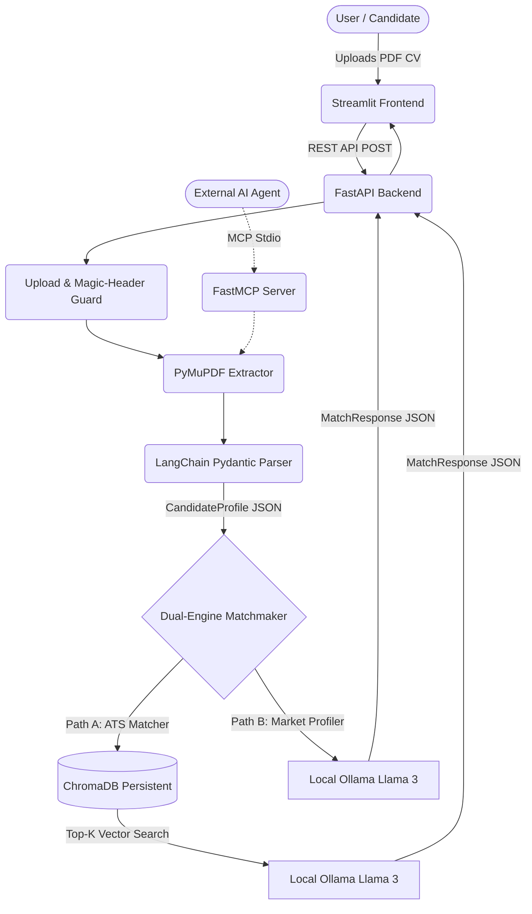

# CV Nexus: Dual-Engine Local AI Career Profiler


**CV Nexus** (`local-ai-career-profiler`) is a privacy-first local AI platform that extracts structured candidate profiles from PDF resumes and evaluates role fit through a **Dual-Engine Architecture**: an internal RAG-powered **ATS Matcher** and a database-free **Open Market Career Profiler**.

Powered entirely by local Ollama LLMs (`llama3`), HuggingFace embeddings (`all-MiniLM-L6-v2`), and persistent ChromaDB storage, CV Nexus guarantees **zero external LLM API egress**—no candidate resume ever leaves your infrastructure.

---

## Core Capabilities

1. **Dual-Engine Analysis**
   - **ATS Matcher (`POST /api/v1/match-cv`)**: Performs vector similarity search against a persistent ChromaDB catalog of internal roles and generates structured fit reasoning via local Llama 3.
   - **Open Market Profiler (`POST /api/v1/profile-cv`)**: Bypasses internal listings to evaluate core strengths, growth areas, and top 3 open-market tech roles.
2. **Hardened Production API**
   - Path-traversal neutralization (`Path(...).name` + UUID-prefixed temp files inside `UPLOAD_DIR`), `.pdf` extension and `%PDF-` magic-header validation, streaming `MAX_UPLOAD_SIZE_MB` limits (HTTP 413), and guaranteed temporary file cleanup.
   - Strict `ALLOWED_ORIGINS` CORS allowlist (wildcard `*` rejected at startup), HTTP security headers, `GET /health` liveness probe, structured leveled logging, and safe masked HTTP 500 responses.
3. **Universal Agentic Integration (MCP)**
   - Exposes `process_and_match_cv` over stdio via FastMCP so compatible AI agents (Claude Desktop, Cursor) can invoke the local profiling pipeline natively.

---

## System Architecture



---

## Quick Start (Makefile)

### Prerequisites
- Python 3.10+
- [Ollama](https://ollama.com/) running locally with `llama3` pulled:
  ```bash
  ollama pull llama3
  ```

### 1. Clone, Configure & Install
```bash
git clone https://github.com/subki72/local-ai-career-profiler.git
cd local-ai-career-profiler
cp .env.example .env
make install
```

### 2. Seed Internal Job Catalog
```bash
make seed
```

### 3. Run API & Frontend
Run each service in a separate terminal:
```bash
make run-api   # FastAPI backend at http://localhost:8000 (Swagger: /docs, Health: /health)
make run-ui    # Streamlit UI at http://localhost:8501
```

### Docker Compose Deployment
```bash
make docker-up
```
The multi-stage `Dockerfile` runs under a dedicated non-root user (`appuser`) with an automated `/health` container healthcheck.

---

## API Reference

| Method | Endpoint | Description |
|---|---|---|
| `GET` | `/health` | Service liveness probe returning version and status |
| `POST` | `/api/v1/match-cv` | Upload PDF resume (`multipart/form-data`, field `file`) for internal ATS matching |
| `POST` | `/api/v1/profile-cv` | Upload PDF resume (`multipart/form-data`, field `file`) for open-market career profiling |

Example request:
```bash
curl -X POST http://localhost:8000/api/v1/match-cv \
  -F "file=@data/raw_cv/sample_cv.pdf;type=application/pdf"
```

---

## Configuration

All runtime settings are validated through Pydantic in `src/config.py` (see `.env.example`):

| Variable | Default | Purpose |
|---|---|---|
| `ALLOWED_ORIGINS` | `http://localhost:8501,http://localhost:3000` | Explicit CORS allowlist (no wildcard `*`) |
| `MAX_UPLOAD_SIZE_MB` | `10` | Maximum accepted PDF size (`1`–`100` MB) |
| `UPLOAD_DIR` | `data/processed` | Isolated temp directory for sanitized uploads |
| `OLLAMA_BASE_URL` | `http://localhost:11434` | Local Ollama inference endpoint |
| `OLLAMA_MODEL` | `llama3` | Local LLM identifier |
| `CHROMA_DB_DIR` | `data/chroma_db` | Persistent ChromaDB directory |
| `API_BASE_URL` | `http://localhost:8000` | Backend URL used by the Streamlit UI |
| `REQUEST_TIMEOUT_SECONDS` | `120` | HTTP request timeout for frontend calls |
| `LOG_LEVEL` | `INFO` | Logging verbosity (`DEBUG`, `INFO`, `WARNING`, `ERROR`, `CRITICAL`) |

---

## Connecting via MCP (For AI Agents)

Add the following entry to your MCP client configuration (e.g., Claude Desktop):

```json
{
  "mcpServers": {
    "cv_nexus": {
      "command": "python",
      "args": ["-m", "src.mcp_server.server"],
      "cwd": "/absolute/path/to/local-ai-career-profiler"
    }
  }
}
```

---

## Testing & Quality Verification

All unit and API integration tests run **100% offline** using FastAPI dependency overrides and stubbed LLM/vector-store adapters:

```bash
make install-dev
make lint
make test
```

---

## Governance & Operations

- Operational Runbook: [docs/RUNBOOK.md](docs/RUNBOOK.md)
- Security Policy & Controls: [SECURITY.md](SECURITY.md)
- Contribution Guide: [CONTRIBUTING.md](CONTRIBUTING.md)
- Release History: [CHANGELOG.md](CHANGELOG.md)
- License: [MIT](LICENSE)
