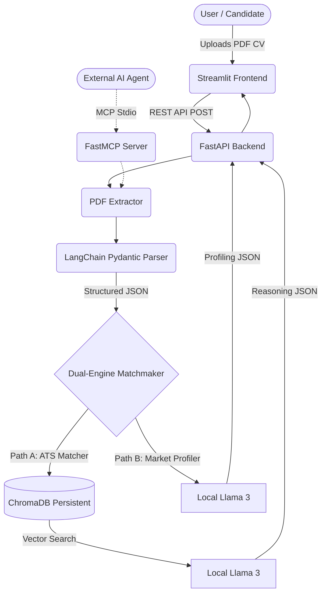

# CV Nexus: Dual-Engine AI Career Profiler


**CV Nexus** is an advanced, privacy-first AI system designed to analyze resumes (PDFs) and match candidates to their ideal tech roles. It features a **Dual-Engine Architecture** capable of acting as both an internal HR ATS (Applicant Tracking System) and an Open Market Career Consultant.

Built entirely with Local LLMs (Llama 3) and HuggingFace Embeddings, this system guarantees **Zero Data Leakage**—no candidate data is ever sent to external APIs.

---

## Core Features

1. **Dual-Engine Analysis:**
   - **ATS Matcher (Closed-Domain RAG):** Matches candidate skills against an internal persistent Vector Database (ChromaDB) of available jobs.
   - **Open Market Profiler (Open-Domain LLM):** Bypasses the database to provide a raw, comprehensive career analysis, identifying strengths, weaknesses, and top 3 market-fit roles.
2. **100% Privacy-First:** Powered by local Ollama (Llama 3) and `all-MiniLM-L6-v2` embeddings. 
3. **Structured Output:** Uses Pydantic to force the LLM into strict JSON schema extractions.
4. **Universal Agentic Port (MCP):** Features a FastMCP server, allowing other AI Agents (like Claude Desktop or Cursor) to plug into the CV Nexus engine and use it as a native tool.

---

## System Architecture



---

## Technology Stack

- **Backend:** FastAPI, Python
- **Frontend:** Streamlit
- **AI & Orchestration:** LangChain, OllamaLLM (Llama 3)
- **Vector Database:** ChromaDB (Persistent)
- **Embeddings:** HuggingFace (`all-MiniLM-L6-v2`)
- **Integration:** FastMCP (Model Context Protocol)

---

## Installation & Quick Start

### 1. Prerequisites
- Python 3.10+ (Conda environment recommended)
- [Ollama](https://ollama.com/) installed and running locally.
- Download the Llama 3 model:
  ```bash
  ollama run llama3
  ```

### 2. Clone & Install
```bash
git clone [https://github.com/yourusername/cv_nexus.git](https://github.com/yourusername/cv_nexus.git)
cd cv_nexus
pip install -r requirements.txt
```

### 3. Seed the Database
Before running the ATS Matcher, populate the local ChromaDB with sample jobs:
```bash
python seed_db.py
```

### 4. Run the Full Stack
You will need two terminals to run the backend and frontend simultaneously.

**Terminal 1 (Backend API):**
```bash
python main.py
```

**Terminal 2 (Frontend UI):**
```bash
streamlit run src/frontend/app.py
```
*Access the Web UI at `http://localhost:8501` and the Swagger API docs at `http://localhost:8000/docs`.*

---

## Connecting via MCP (For AI Agents)
To use CV Nexus as a tool inside an MCP-compatible agent (like Claude Desktop), add the following to your agent's configuration file:

```json
"mcpServers": {
  "cv_nexus": {
    "command": "python",
    "args": ["/absolute/path/to/cv_nexus/src/mcp_server/server.py"]
  }
}
```
